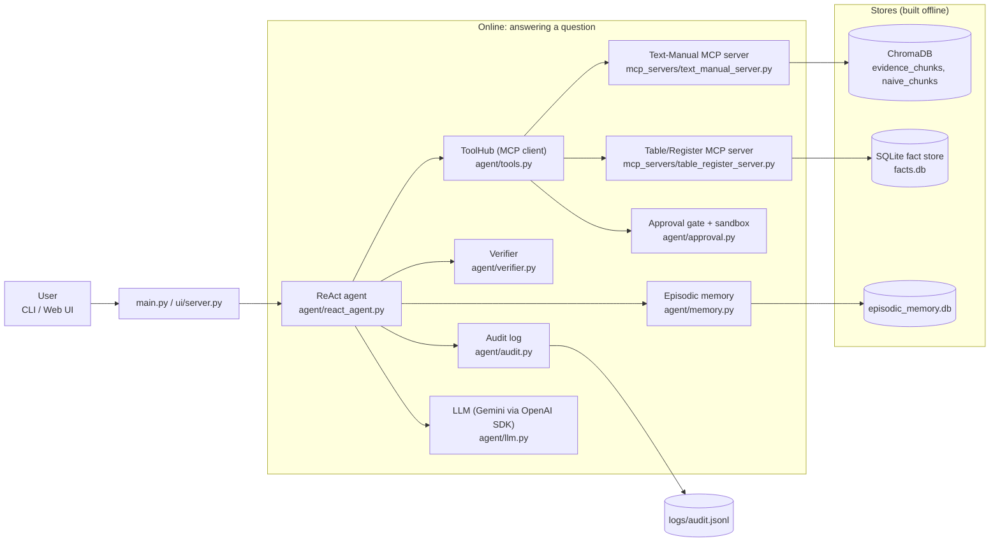
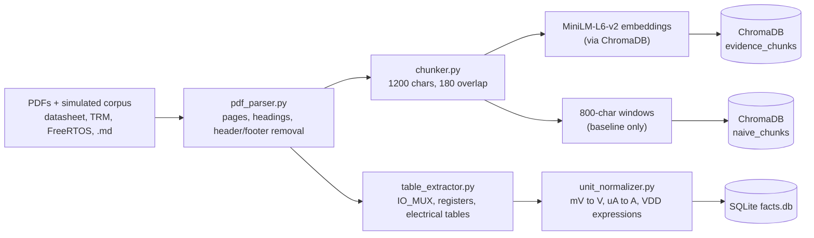
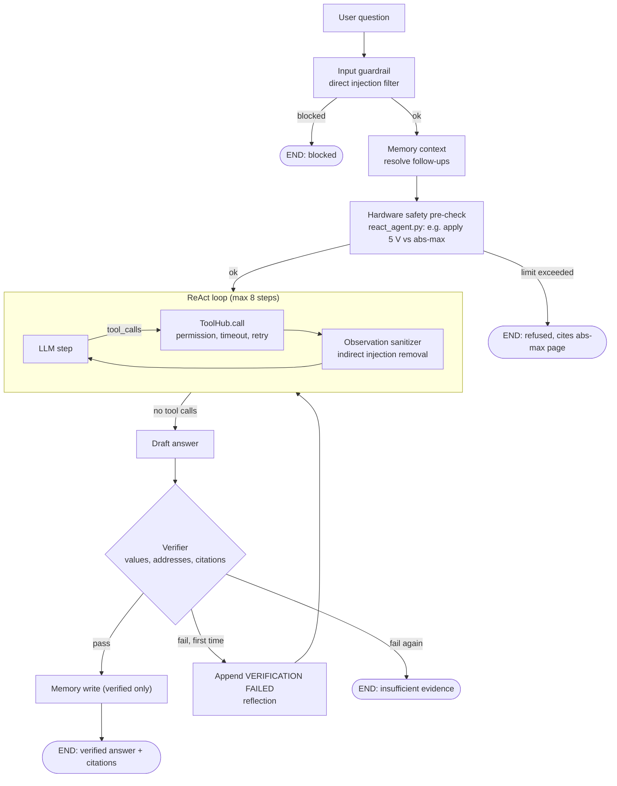
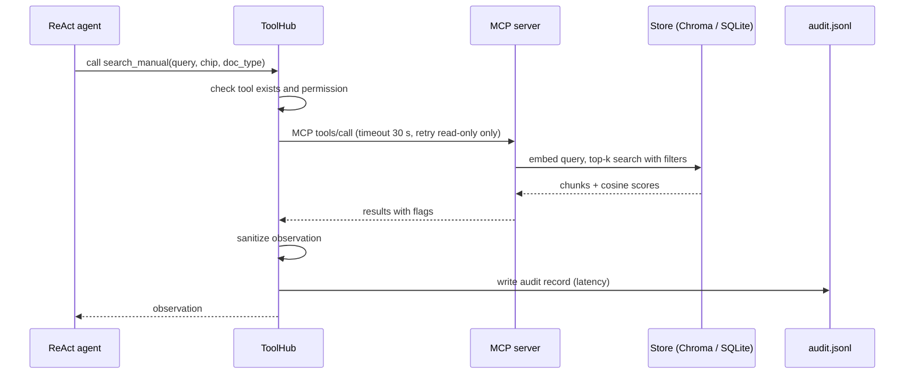

# Architecture: Agentic RAG for Hardware Specs

## 1. System overview



## 2. Offline pipeline (ingestion)

Run with `python -m ingestion.build_index`.



## 3. Online agent loop



## 4. Sequence of one tool call



## 5. Safety layers

| Layer | Where | Purpose |
|---|---|---|
| Input guardrail | `agent/guardrail.py` | Blocks direct prompt injection |
| Hardware pre-check | `agent/react_agent.py` | Refuses values beyond absolute maximum |
| Least privilege | `agent/tools.py` | Only read-only tools run automatically |
| Observation sanitizer | `agent/guardrail.py` | Removes indirect injection from tool output |
| Approval gate | `agent/approval.py` | Human approval for the only write tool |
| Verifier | `agent/verifier.py` | Every number and citation must match evidence |
| Audit | `agent/audit.py` | JSONL trail of every tool call |

## 6. Folder map

```
hw_agentic_rag/
  config.py                    settings, paths, chunk sizes, LLM config
  main.py  run_all.py          CLI and one-command pipeline
  ingestion/                   parse, chunk, extract tables, normalize units
  stores/                      ChromaDB vector store, SQLite fact store
  mcp_servers/                 text-manual and table-register MCP servers
  agent/                       ReAct loop, LLM, tools, guardrail, verifier, memory, audit, approval
  ui/                          HTTP server and web page
  eval/                        benchmark, attacks, baselines, evaluation runner
  docs/                        explanation.html, architecture.md
```
