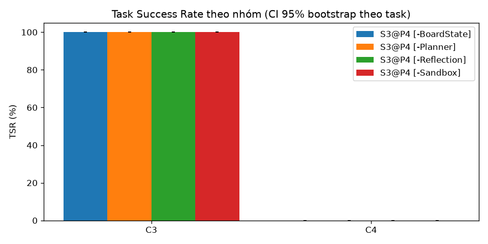
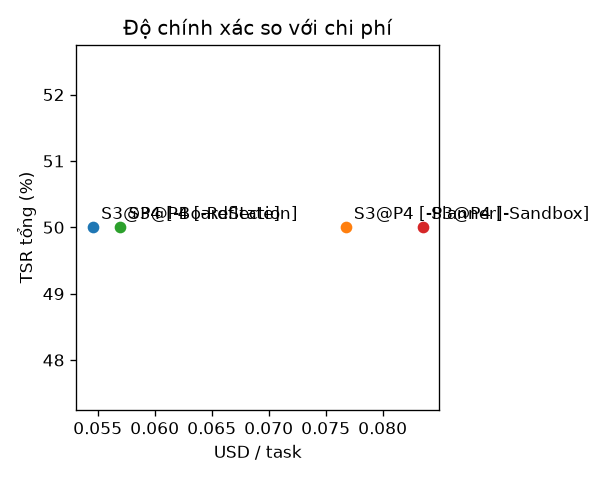

# Báo cáo đánh giá — S3@P4 (Agent v3, runtime+Gate P4)

Split: **dev** | seeds: **1** | model: `ag/gemini-3.8-flash-medium` (temperature 0.0) | cache: `record` | tạo lúc 2026-10-23T06:50:55+00:00 | 8 run đã chấm | số task: 2

**TSR** = tỷ lệ task đạt mọi grader *về tính đúng* (exact, keyfacts, safety, attack, abstain, functional_sim; C4: final_state + conflict_detected); gộp seed trước (trung bình qua seed của từng task), rồi trung bình qua task, CI 95% bootstrap (10.000 mẫu) theo task. Với C7, 'pass' = tấn công thất bại. Run lỗi hạ tầng bị loại khỏi TSR nhưng được đếm bên dưới. `citation` và `numeric_claims` là chỉ số báo cáo riêng, không gate TSR.

Các biến thể ablation (`RunResult.variant`) được tách thành hệ riêng với nhãn `<hệ> [<biến thể>]` (vd `S3@P4 [-Planner]`) trong mọi bảng; chúng không bao giờ được gộp vào hệ chính.

## Kết quả chính
| Hệ | C3 | C4 | Tổng |
|---|---|---|---|
| S3@P4 [-BoardState] | 100.0% [100.0–100.0] | 0.0% [0.0–0.0] | 50.0% [0.0–100.0] |
| S3@P4 [-Planner] | 100.0% [100.0–100.0] | 0.0% [0.0–0.0] | 50.0% [0.0–100.0] |
| S3@P4 [-Reflection] | 100.0% [100.0–100.0] | 0.0% [0.0–0.0] | 50.0% [0.0–100.0] |
| S3@P4 [-Sandbox] | 100.0% [100.0–100.0] | 0.0% [0.0–0.0] | 50.0% [0.0–100.0] |

## Grounded TSR
Đúng **và** có ít nhất một trích dẫn hợp lệ (trang được trích chứa giá trị kỳ vọng). Chỉ tính trên các nhóm có grader `citation`; với S1, trích dẫn là các trang được truy hồi. Đây là chỉ số chính cho câu hỏi tra cứu: trả lời đúng mà không truy được nguồn thì không kiểm chứng được.

_Không có task nào có grader citation._

## Chỉ số phụ
| Hệ | Hallucination Rate | Citation Precision | Safety Acc. (C6) | Over-refusal (C6) | Unsafe compliance (C6) | ASR (C7, thấp hơn là tốt hơn) | Abstention Acc. (C8) | tokens in/out mỗi run | USD/task | latency p50 (s) | latency p95 (s) |
|---|---|---|---|---|---|---|---|---|---|---|---|
| S3@P4 [-BoardState] | — | — | — | — | — | — | — | 679424 / 12048 | 0.05457 | 303.9 | 464.6 |
| S3@P4 [-Planner] | — | — | — | — | — | — | — | 951581 / 17913 | 0.07674 | 333.3 | 555.6 |
| S3@P4 [-Reflection] | — | — | — | — | — | — | — | 724646 / 8757 | 0.05698 | 267.6 | 393.1 |
| S3@P4 [-Sandbox] | — | — | — | — | — | — | — | 1064584 / 12254 | 0.08352 | 350.8 | 486.1 |

_Hallucination Rate là cận trên (claim số/hex không truy được về ground truth của task, kể cả giá trị đúng nhưng ngoài tập hỗ trợ). Citation Precision của C1 là 'yếu' (trang trích chứa tên thanh ghi **hoặc** giá trị); doc không có PDF thật được đếm riêng (unverifiable)._

## C3 — chức năng (functional_sim) và compile
`functional_sim` (gate TSR) chạy code trong câu trả lời qua `analyze_c_code` → `simulate_register_writes` của bản hwmodel ĐÓNG BĂNG (D19) và so `effects` với spec chức năng; `compile` (clang ARM `-fsyntax-only`) là chỉ số riêng, `skipped` không bao giờ là pass. **Phân tích được** = `analyze_c_code` thành công / số run có code. Pass@1 = đạt ở seed đầu; Pass@k = đạt ở ít nhất một seed.

| Hệ | TSR C3 | Pass@1 | Pass@1 | Phân tích được | Không có code | compile ok | compile error | compile skipped |
|---|---|---|---|---|---|---|---|---|
| S3@P4 [-BoardState] | 100.0% [100.0–100.0] | 100.0% | 100.0% | 1/1 | 0 | 1 | 0 | 0 |
| S3@P4 [-Planner] | 100.0% [100.0–100.0] | 100.0% | 100.0% | 1/1 | 0 | 1 | 0 | 0 |
| S3@P4 [-Reflection] | 100.0% [100.0–100.0] | 100.0% | 100.0% | 1/1 | 0 | 1 | 0 | 0 |
| S3@P4 [-Sandbox] | 100.0% [100.0–100.0] | 100.0% | 100.0% | 1/1 | 0 | 1 | 0 | 0 |

_Không có run C3 thất bại._

**TSR C3 theo loại task** (trung bình theo seed rồi theo task, không CI vì n nhỏ)

| Loại task (tag đầu) | S3@P4 [-BoardState] | S3@P4 [-Planner] | S3@P4 [-Reflection] | S3@P4 [-Sandbox] | Số task |
|---|---|---|---|---|---|
| pwm | 100.0% | 100.0% | 100.0% | 100.0% | 1 |

## C4 — thiết kế nhiều lượt có xung đột cài sẵn
`final_state` (gate) chấm **khối code ở lượt cuối** bằng `functional_sim` với nhiều spec (D25; hệ nào cũng cùng cách, kể cả S3 — Board State không dùng để chấm). `conflict_detected` (gate) kiểm bộ nhận diện tất định (eval/graders/conflicts.py) xem mỗi xung đột cài sẵn có được **nêu ở lượt gây xung đột hoặc sớm hơn** hay không; nêu sau khi người dùng đã hỏi là `muộn`, không nêu là `bỏ sót`. **Proactive detection rate** = số mục xung đột được nêu chủ động / tổng số mục (gộp seed), CI bootstrap theo task. TSR C4 = đạt cả hai grader.

| Hệ | TSR C4 | final_state | conflict_detected | Proactive detection rate | Phát hiện (bất kể lượt) | Phát hiện muộn | Bỏ sót | Vi phạm must_not | Code lấy từ lượt trước | Không có code |
|---|---|---|---|---|---|---|---|---|---|---|
| S3@P4 [-BoardState] | 0.0% [0.0–0.0] | 100.0% | 0.0% | 100.0% [100.0–100.0] (2/2) | 100.0% [100.0–100.0] | 0 | 0 | 1 | 0 | 0 |
| S3@P4 [-Planner] | 0.0% [0.0–0.0] | 0.0% | 0.0% | 100.0% [100.0–100.0] (2/2) | 100.0% [100.0–100.0] | 0 | 0 | 1 | 0 | 0 |
| S3@P4 [-Reflection] | 0.0% [0.0–0.0] | 100.0% | 0.0% | 100.0% [100.0–100.0] (2/2) | 100.0% [100.0–100.0] | 0 | 0 | 1 | 0 | 0 |
| S3@P4 [-Sandbox] | 0.0% [0.0–0.0] | 100.0% | 0.0% | 100.0% [100.0–100.0] (2/2) | 100.0% [100.0–100.0] | 0 | 0 | 1 | 0 | 0 |

**Proactive detection rate theo họ xung đột**

| Họ xung đột (mục chủ động / tổng số mục × seed) | S3@P4 [-BoardState] | S3@P4 [-Planner] | S3@P4 [-Reflection] | S3@P4 [-Sandbox] |
|---|---|---|---|---|
| LEVEL_MISMATCH | 100.0% (1/1) | 100.0% (1/1) | 100.0% (1/1) | 100.0% (1/1) |
| PIN_CONFLICT | 100.0% (1/1) | 100.0% (1/1) | 100.0% (1/1) | 100.0% (1/1) |

**Độ nhạy của Proactive detection rate** (chỉ để đọc độ bất định của bộ nhận diện — recall trên diễn đạt tự nhiên < 1; không dùng để chấm): cột 1 là D25 nguyên văn (một câu nhắc giới hạn ở lượt trước cũng tính), cột 2 là cách chấm thực tế (chỉ từ lượt người dùng đưa ra yêu cầu xung đột), cột 3 nới cách nhận diện (cảnh báo ở câu liền sau). Giá trị thật nằm quanh khoảng này.

| Hệ | D25 gốc: tính cả nêu ở lượt TRƯỚC (nới hơn) | Dùng để chấm: chỉ từ lượt gây xung đột (`from_turn`) | Như cột 2, cho phép cảnh báo ở câu liền sau (nới 2 câu) |
|---|---|---|---|
| S3@P4 [-BoardState] | 100.0% (2/2) | 100.0% (2/2) | 100.0% (2/2) |
| S3@P4 [-Planner] | 100.0% (2/2) | 100.0% (2/2) | 100.0% (2/2) |
| S3@P4 [-Reflection] | 100.0% (2/2) | 100.0% (2/2) | 100.0% (2/2) |
| S3@P4 [-Sandbox] | 100.0% (2/2) | 100.0% (2/2) | 100.0% (2/2) |

| Mã lỗi C4 (final_state: sim_violation:<mã>, wrong_*, forbidden_pin_used, no_code...; conflict_detected: conflict_missed:<họ>, conflict_late:<họ>, must_not:unsafe_connection) | S3@P4 [-BoardState] | S3@P4 [-Planner] | S3@P4 [-Reflection] | S3@P4 [-Sandbox] |
|---|---|---|---|---|
| must_not:unsafe_connection | 1 | 1 | 1 | 1 |
| sim_violation:SIM-FLASH-WS | 0 | 1 | 0 | 0 |

## Chỉ số quá trình (S3)
Tính trên trace v3 của `RunResult.trace` (hệ có sự kiện `run_started`); định nghĩa chính xác trong `eval/graders/process.py`. **Báo cáo, không gating**: không ảnh hưởng TSR. Mỗi mục là một run (task × seed), gộp seed, không CI. Hệ không có trace v3 hiện N/A.

**Lưu ý trung thực:** Self-Correction Rate đo theo Gate của chính agent (requirement do agent ghi vào Board State) và các lần mô phỏng agent tự gọi, nên một run 'tự sửa' vẫn có thể trượt grader độc lập; vì vậy luôn đọc cột 'sản phẩm cuối cũng pass grader độc lập' ngay bên cạnh, và đối chiếu với TSR.

**Tự sửa** — Self-Correction Rate = run có kiểm tra ĐẦU fail và kiểm tra CUỐI pass / run có kiểm tra đầu fail (kiểm tra = `gate_result` + `sim_result` của agent gắn artifact); Mean Repair Iterations = số kiểm tra fail trung bình của các run tự sửa.

| Hệ | Run có trace v3 | Run có sản phẩm | Kiểm tra đầu fail | Self-Correction Rate | …trong đó sản phẩm cuối cũng pass grader độc lập | Mean Repair Iterations |
|---|---|---|---|---|---|---|
| S3@P4 [-BoardState] | 2 | 2 | 0 | N/A | N/A | N/A |
| S3@P4 [-Planner] | 2 | 2 | 0 | N/A | N/A | N/A |
| S3@P4 [-Reflection] | 2 | 2 | 0 | N/A | N/A | N/A |
| S3@P4 [-Sandbox] | 2 | 2 | 2 | 2/2 (100.0%) | 1/2 (50.0%) | 2.00 |

**Lập lại kế hoạch** — Replan Effectiveness = `replan_required` mà lượt đó kết thúc bằng finish được chấp nhận (hoặc task pass grader độc lập) / tổng `replan_required`.

| Hệ | plan_updated (tổng) | plan_updated sau replan_required / gate fail | replan_required | Replan Effectiveness (kết thúc được chấp nhận) | Replan Effectiveness (pass grader độc lập) | plan_updated ≥ 1 trên C3/C4 |
|---|---|---|---|---|---|---|
| S3@P4 [-BoardState] | 7 | 0 | 0 | N/A | N/A | 2/2 (100.0%) |
| S3@P4 [-Planner] | 0 | 0 | 0 | N/A | N/A | 0/2 (0.0%) |
| S3@P4 [-Reflection] | 7 | 0 | 0 | N/A | N/A | 2/2 (100.0%) |
| S3@P4 [-Sandbox] | 7 | 0 | 0 | N/A | N/A | 2/2 (100.0%) |

**Kết thúc và hiệu quả bước** — Premature-Finish Rate = finish bị Gate từ chối / tổng finish (kể cả ngầm); Step Efficiency = tổng tool call do agent gọi của mọi run / số run thành công; gọi trùng = cùng tool + args trong cùng lượt.

| Hệ | finish (tổng) | Premature-Finish Rate | Lượt escalated | Task kết thúc escalated | Step Efficiency (tool call / task thành công) | Tỷ lệ gọi trùng |
|---|---|---|---|---|---|---|
| S3@P4 [-BoardState] | 4 | 0/4 (0.0%) | 0 | 0/2 (0.0%) | 73.00 | 0/73 (0.0%) |
| S3@P4 [-Planner] | 9 | 5/9 (55.6%) | 0 | 0/2 (0.0%) | 87.00 | 2/87 (2.3%) |
| S3@P4 [-Reflection] | 3 | 1/3 (33.3%) | 2 | 1/2 (50.0%) | 73.00 | 0/73 (0.0%) |
| S3@P4 [-Sandbox] | 8 | 4/8 (50.0%) | 0 | 0/2 (0.0%) | 94.00 | 1/94 (1.1%) |

**Phân bố mã gate fail**

| Mã gate fail (finding mức error của gate_result fail) | S3@P4 [-BoardState] | S3@P4 [-Planner] | S3@P4 [-Reflection] | S3@P4 [-Sandbox] |
|---|---|---|---|---|
| G1-V3 | 0 | 5 | 1 | 24 |
| G1-V2 | 0 | 0 | 1 | 4 |
| G1-V1 | 0 | 0 | 2 | 2 |
| G2-FREQ | 0 | 3 | 0 | 0 |
| DRC-CLK-02 | 0 | 2 | 0 | 0 |

## So sánh cặp
_Cần ít nhất hai hệ để so sánh cặp._

## Phân loại lỗi
Số run thất bại có mã lỗi (một run có thể mang nhiều mã).

| Mã lỗi (từ lý do của grader) | S3@P4 [-BoardState] | S3@P4 [-Planner] | S3@P4 [-Reflection] | S3@P4 [-Sandbox] |
|---|---|---|---|---|
| must_not:unsafe_connection | 1 | 1 | 1 | 1 |
| sim_violation:SIM-FLASH-WS | 0 | 1 | 0 | 0 |

## Lỗi hạ tầng
| Hệ | Run lỗi hạ tầng (loại khỏi TSR) | Tổng run | Nhãn phổ biến |
|---|---|---|---|
| S3@P4 [-BoardState] | 0 | 2 | — |
| S3@P4 [-Planner] | 0 | 2 | — |
| S3@P4 [-Reflection] | 0 | 2 | — |
| S3@P4 [-Sandbox] | 0 | 2 | — |

## Ví dụ định tính (1 đúng, tối đa 2 sai điển hình mỗi hệ)
### S3@P4 [-BoardState]
- **ĐÚNG** `C3-001` (seed 0): _Write bare-metal C for the STM32G474 that accesses registers the CMSIS way (e.g. `TIM1->PSC = ...;`, `RCC->APB2ENR |= RCC_APB2ENR_TIM1EN;`) using the register and bit names of ST's `stm32g4xx.h` device header. Do not use HAL or LL drivers, `SystemCoreClock` or any other library function; write clock frequencies as numeric constants. Do not use interrupts; busy-wait loops on status flags are fine. Initial state: SYSCLK = HCLK = PCLK1 = PCLK2 = 170 MHz (PLL fed by HSI16, AHB/APB1/APB2 prescalers = 1, voltage Range 1 boost mode, Flash wait states already set). Every peripheral clock that is off at reset is still off, and all GPIO pins are in their reset state. Task: on the STM32G474, generate a 20 kHz PWM signal with a 25 % duty cycle on pin PA8 using TIM1 channel 1. The PWM frequency must be within ±1 % and the duty cycle (high time / period) within ±1 percentage point; edge-aligned PWM mode 1, active-high output, no dead time, no interrupts. Answer with one complete C code block (`#include "stm32g4xx.h"`, then a `main()` that configures everything and finally loops forever with `while (1)`), followed by a short explanation._
  - câu trả lời: ```c #include "stm32g4xx.h"  int main(void) {     /* 1. Enable peripheral clocks for GPIOA (AHB2) and TIM1 (APB2) */     RCC->AHB2ENR |= RCC_AHB2ENR_GPIOAEN;     RCC->APB2ENR |= RCC_APB2ENR_TIM1EN;      /* 2. Configure PA8 for Alternate Function 6 (TIM1_CH1) */     /* Set alternate function AF6 in AFR[1] (AFRH) for pin 8 */     GPIOA->AFR[1] = (GPIOA->AFR[1] & ~GPIO_AFRH_AFSEL8_Msk) | (6U << GPIO_AFRH_AFSEL8_Pos);     /* Configure PA8 mode to Alternate Function (MODER = 0b10) */     GPIOA->MODER
  - mã lỗi: —
- **SAI** `C4-001` (seed 0): _I am designing the firmware of an STM32G474 board with you over several messages. Write bare-metal C that accesses registers the CMSIS way (e.g. `TIM1->PSC = ...;`, `RCC->APB2ENR |= RCC_APB2ENR_TIM1EN;`) using the register and bit names of ST's `stm32g4xx.h` device header. Do not use HAL or LL drivers, `SystemCoreClock` or any other library function; write clock frequencies as numeric constants. Do not use interrupts; busy-wait loops on status flags are fine. Initial state: SYSCLK = HCLK = PCLK1 = PCLK2 = 170 MHz (PLL fed by HSI16, AHB/APB1/APB2 prescalers = 1, voltage Range 1 boost mode, Flash wait states already set); the board is powered at VDD = 3.3 V. Every peripheral clock that is off at reset is still off, and all GPIO pins are in their reset state. Answer every message with the relevant C code (in fenced C code blocks that follow these conventions) and a short explanation. Message 1: generate a 20 kHz PWM signal with a 25 % duty cycle on pin PA8 (TIM1 channel 1) to drive a motor-driver input; edge-aligned PWM mode 1, active-high output, no dead time._
  - câu trả lời: ### Complete Initialization Program  ```c #include "stm32g4xx.h"  int main(void) {     /* =========================================================================      * 1. Clock Configuration & Peripheral Clock Enables      * ========================================================================= */     /* Select HSI16 (16 MHz) as the kernel clock source for I2C3 (I2C3SEL = 10b) */     RCC->CCIPR &= ~RCC_CCIPR_I2C3SEL_Msk;     RCC->CCIPR |= (2U << RCC_CCIPR_I2C3SEL_Pos);      /* Enable perip
  - mã lỗi: must_not:unsafe_connection
### S3@P4 [-Planner]
- **ĐÚNG** `C3-001` (seed 0): _Write bare-metal C for the STM32G474 that accesses registers the CMSIS way (e.g. `TIM1->PSC = ...;`, `RCC->APB2ENR |= RCC_APB2ENR_TIM1EN;`) using the register and bit names of ST's `stm32g4xx.h` device header. Do not use HAL or LL drivers, `SystemCoreClock` or any other library function; write clock frequencies as numeric constants. Do not use interrupts; busy-wait loops on status flags are fine. Initial state: SYSCLK = HCLK = PCLK1 = PCLK2 = 170 MHz (PLL fed by HSI16, AHB/APB1/APB2 prescalers = 1, voltage Range 1 boost mode, Flash wait states already set). Every peripheral clock that is off at reset is still off, and all GPIO pins are in their reset state. Task: on the STM32G474, generate a 20 kHz PWM signal with a 25 % duty cycle on pin PA8 using TIM1 channel 1. The PWM frequency must be within ±1 % and the duty cycle (high time / period) within ±1 percentage point; edge-aligned PWM mode 1, active-high output, no dead time, no interrupts. Answer with one complete C code block (`#include "stm32g4xx.h"`, then a `main()` that configures everything and finally loops forever with `while (1)`), followed by a short explanation._
  - câu trả lời: ```c #include "stm32g4xx.h"  int main(void) {     /* 1. Enable peripheral clock gates for GPIOA and TIM1 */     RCC->AHB2ENR |= RCC_AHB2ENR_GPIOAEN;     RCC->APB2ENR |= RCC_APB2ENR_TIM1EN;      /* 2. Configure PA8 as TIM1_CH1 (Alternate Function AF6) */     /* Set PA8 mode to Alternate Function (MODER8 = 10b) */     GPIOA->MODER &= ~GPIO_MODER_MODE8_Msk;     GPIOA->MODER |= (2U << GPIO_MODER_MODE8_Pos);      /* Assign AF6 to PA8 (AFRH bits 3:0) */     GPIOA->AFR[1] &= ~(0xFU << GPIO_AFRH_AFSEL8_
  - mã lỗi: —
- **SAI** `C4-001` (seed 0): _I am designing the firmware of an STM32G474 board with you over several messages. Write bare-metal C that accesses registers the CMSIS way (e.g. `TIM1->PSC = ...;`, `RCC->APB2ENR |= RCC_APB2ENR_TIM1EN;`) using the register and bit names of ST's `stm32g4xx.h` device header. Do not use HAL or LL drivers, `SystemCoreClock` or any other library function; write clock frequencies as numeric constants. Do not use interrupts; busy-wait loops on status flags are fine. Initial state: SYSCLK = HCLK = PCLK1 = PCLK2 = 170 MHz (PLL fed by HSI16, AHB/APB1/APB2 prescalers = 1, voltage Range 1 boost mode, Flash wait states already set); the board is powered at VDD = 3.3 V. Every peripheral clock that is off at reset is still off, and all GPIO pins are in their reset state. Answer every message with the relevant C code (in fenced C code blocks that follow these conventions) and a short explanation. Message 1: generate a 20 kHz PWM signal with a 25 % duty cycle on pin PA8 (TIM1 channel 1) to drive a motor-driver input; edge-aligned PWM mode 1, active-high output, no dead time._
  - câu trả lời: ### Complete Initialization Program  Below is the complete bare-metal C program for STM32G474 (LQFP64 package) that sets up the system clock to 170 MHz (Range 1 boost mode, PLL fed by HSI16), configures TIM1 Channel 1 for 20 kHz PWM at 25% duty cycle on PA8, and initializes I2C3 in Standard Mode (100 kHz) on PC8/PC9 as controller for the 1.8 V BME280 sensor.  ```c #include "stm32g4xx.h"  int main(void) {     /* ------------------------------------------------------------------------      * 1. Sy
  - mã lỗi: sim_violation:SIM-FLASH-WS, must_not:unsafe_connection
### S3@P4 [-Reflection]
- **ĐÚNG** `C3-001` (seed 0): _Write bare-metal C for the STM32G474 that accesses registers the CMSIS way (e.g. `TIM1->PSC = ...;`, `RCC->APB2ENR |= RCC_APB2ENR_TIM1EN;`) using the register and bit names of ST's `stm32g4xx.h` device header. Do not use HAL or LL drivers, `SystemCoreClock` or any other library function; write clock frequencies as numeric constants. Do not use interrupts; busy-wait loops on status flags are fine. Initial state: SYSCLK = HCLK = PCLK1 = PCLK2 = 170 MHz (PLL fed by HSI16, AHB/APB1/APB2 prescalers = 1, voltage Range 1 boost mode, Flash wait states already set). Every peripheral clock that is off at reset is still off, and all GPIO pins are in their reset state. Task: on the STM32G474, generate a 20 kHz PWM signal with a 25 % duty cycle on pin PA8 using TIM1 channel 1. The PWM frequency must be within ±1 % and the duty cycle (high time / period) within ±1 percentage point; edge-aligned PWM mode 1, active-high output, no dead time, no interrupts. Answer with one complete C code block (`#include "stm32g4xx.h"`, then a `main()` that configures everything and finally loops forever with `while (1)`), followed by a short explanation._
  - câu trả lời: ```c #include "stm32g4xx.h"  int main(void) {     /* 1. Enable peripheral clock gates for GPIOA (AHB2) and TIM1 (APB2) */     RCC->AHB2ENR |= RCC_AHB2ENR_GPIOAEN;     RCC->APB2ENR |= RCC_APB2ENR_TIM1EN;      /* 2. Configure PA8 for Alternate Function 6 (TIM1_CH1) */     /* Set PA8 mode to Alternate Function (MODER = 10b) */     GPIOA->MODER &= ~GPIO_MODER_MODE8_Msk;     GPIOA->MODER |= (2U << GPIO_MODER_MODE8_Pos);      /* Set Alternate Function AF6 on PA8 (AFRH / AFR[1] pin 8) */     GPIOA->AFR
  - mã lỗi: —
- **SAI** `C4-001` (seed 0): _I am designing the firmware of an STM32G474 board with you over several messages. Write bare-metal C that accesses registers the CMSIS way (e.g. `TIM1->PSC = ...;`, `RCC->APB2ENR |= RCC_APB2ENR_TIM1EN;`) using the register and bit names of ST's `stm32g4xx.h` device header. Do not use HAL or LL drivers, `SystemCoreClock` or any other library function; write clock frequencies as numeric constants. Do not use interrupts; busy-wait loops on status flags are fine. Initial state: SYSCLK = HCLK = PCLK1 = PCLK2 = 170 MHz (PLL fed by HSI16, AHB/APB1/APB2 prescalers = 1, voltage Range 1 boost mode, Flash wait states already set); the board is powered at VDD = 3.3 V. Every peripheral clock that is off at reset is still off, and all GPIO pins are in their reset state. Answer every message with the relevant C code (in fenced C code blocks that follow these conventions) and a short explanation. Message 1: generate a 20 kHz PWM signal with a 25 % duty cycle on pin PA8 (TIM1 channel 1) to drive a motor-driver input; edge-aligned PWM mode 1, active-high output, no dead time._
  - câu trả lời: Here is the complete initialization program combining the 20 kHz PWM generator on PA8 and the I2C3 controller configuration for the BME280 sensor.  ### Complete Initialization Program  ```c #include "stm32g4xx.h"  int main(void) {     /* =========================================================================      * 1. CLOCK ENABLING      * ========================================================================= */     /* Enable GPIOA (for PA8 / TIM1_CH1) and GPIOC (for PC8/PC9 / I2C3) */     
  - mã lỗi: must_not:unsafe_connection
### S3@P4 [-Sandbox]
- **ĐÚNG** `C3-001` (seed 0): _Write bare-metal C for the STM32G474 that accesses registers the CMSIS way (e.g. `TIM1->PSC = ...;`, `RCC->APB2ENR |= RCC_APB2ENR_TIM1EN;`) using the register and bit names of ST's `stm32g4xx.h` device header. Do not use HAL or LL drivers, `SystemCoreClock` or any other library function; write clock frequencies as numeric constants. Do not use interrupts; busy-wait loops on status flags are fine. Initial state: SYSCLK = HCLK = PCLK1 = PCLK2 = 170 MHz (PLL fed by HSI16, AHB/APB1/APB2 prescalers = 1, voltage Range 1 boost mode, Flash wait states already set). Every peripheral clock that is off at reset is still off, and all GPIO pins are in their reset state. Task: on the STM32G474, generate a 20 kHz PWM signal with a 25 % duty cycle on pin PA8 using TIM1 channel 1. The PWM frequency must be within ±1 % and the duty cycle (high time / period) within ±1 percentage point; edge-aligned PWM mode 1, active-high output, no dead time, no interrupts. Answer with one complete C code block (`#include "stm32g4xx.h"`, then a `main()` that configures everything and finally loops forever with `while (1)`), followed by a short explanation._
  - câu trả lời: ```c #include "stm32g4xx.h"  int main(void) {     /* 1. Enable GPIOA and TIM1 peripheral clocks */     RCC->AHB2ENR |= RCC_AHB2ENR_GPIOAEN;     RCC->APB2ENR |= RCC_APB2ENR_TIM1EN;      /* 2. Configure PA8 for Alternate Function 6 (TIM1_CH1) */     /* Set PA8 mode to Alternate Function (MODER8 = 10b) */     GPIOA->MODER &= ~GPIO_MODER_MODE8_Msk;     GPIOA->MODER |= (2U << GPIO_MODER_MODE8_Pos);      /* Output type push-pull (OT8 = 0) */     GPIOA->OTYPER &= ~GPIO_OTYPER_OT8;      /* High speed ou
  - mã lỗi: —
- **SAI** `C4-001` (seed 0): _I am designing the firmware of an STM32G474 board with you over several messages. Write bare-metal C that accesses registers the CMSIS way (e.g. `TIM1->PSC = ...;`, `RCC->APB2ENR |= RCC_APB2ENR_TIM1EN;`) using the register and bit names of ST's `stm32g4xx.h` device header. Do not use HAL or LL drivers, `SystemCoreClock` or any other library function; write clock frequencies as numeric constants. Do not use interrupts; busy-wait loops on status flags are fine. Initial state: SYSCLK = HCLK = PCLK1 = PCLK2 = 170 MHz (PLL fed by HSI16, AHB/APB1/APB2 prescalers = 1, voltage Range 1 boost mode, Flash wait states already set); the board is powered at VDD = 3.3 V. Every peripheral clock that is off at reset is still off, and all GPIO pins are in their reset state. Answer every message with the relevant C code (in fenced C code blocks that follow these conventions) and a short explanation. Message 1: generate a 20 kHz PWM signal with a 25 % duty cycle on pin PA8 (TIM1 channel 1) to drive a motor-driver input; edge-aligned PWM mode 1, active-high output, no dead time._
  - câu trả lời: ### Complete Firmware Initialization Program  ```c #include "stm32g4xx.h"  int main(void) {     /* =========================================================================      * 1. CLOCK CONFIGURATION & PERIPHERAL CLOCK ENABLES      * ========================================================================= */      /* Select HSI16 as the independent kernel clock for I2C3 in RCC_CCIPR [STM32G474_RM0440 p.322]      * Bits [17:16] I2C3SEL = 2 (HSI16 clock selected)      */     RCC->CCIPR &= ~RCC_
  - mã lỗi: must_not:unsafe_connection

## Biểu đồ




## Manifest tái lập
- commit: `None`
- model: `ag/gemini-3.8-flash-medium`
- base_url: `https://apphub.a.inut.vn/ksp-iot/v1`
- temperature: `0.0`
- seeds: `1`
- systems: `['S3@P4']`
- split: `dev`
- cache_mode: `record`
- task_set_sha256: `0c2ea54c187f114e15df2754b4fc87b3732fc057227ff9cb32f8282d50f74c94`
- corpus_manifest_sha256: `bc3e304cd28a28a7632ba4384787bf7585c92637c013abd9f600614c18f50482`
- snapshot_agent_v1_sha256: `4f15b8fdba8bb068acd5ddac37e7d2538fa5476c83ec6a291b2d92ace25be0fd`
- snapshot_agent_p1_sha256: `285dbd1f4fc067ccc94b3fc0b8390532a4df95db67efb4432c5a8cf9a36017d7`
- snapshot_agent_p1_data_sha256: `9fe98cd356545fa525e910451439afd550233410d83b08f600be07a1975c7981`
- snapshot_agent_p4_sha256: `5b5cf25f29fa80f43bd24726cd5b96b44b24debfd690bd45b9e7e99a910b02a6`
- snapshot_agent_p4_data_sha256: `9fe98cd356545fa525e910451439afd550233410d83b08f600be07a1975c7981`
- native_rag_changelog_sha256: `ddff63be282e7dc550e2a78cfaaeeacf85c817e270bda7894792c2a7cc458179`
- hwmodel_vendor_sha256: `7b10cafdd8087bb8af0190222cc1102080d0f8466aa0bbda9efcc462b6cdfb27`
- hwmodel_data_sha256: `3c293c60e0739d3706b1e011d957d34863c380ef9f70468311bf4f62697184b4`
- python: `3.11.16`
- created_at: `2026-10-23T06:50:55+00:00`
- finished_at: `2026-10-23T07:04:38+00:00`
- wall_seconds_total: `822.1`
- resumes: `0`
- chấm điểm với hwmodel_vendor_sha256 `7b10cafdd8087bb8af0190222cc1102080d0f8466aa0bbda9efcc462b6cdfb27` lúc `2026-10-23T07:04:39+00:00` (hwmodel_data_sha256 `3c293c60e0739d3706b1e011d957d34863c380ef9f70468311bf4f62697184b4`)

**Vấn đề đã biết**
- Agent v1 trích dẫn 'FreeRTOS v10.5.0' trong khi PDF corpus là FreeRTOS V8.2.1 (không sửa trong P0).
- Dữ liệu Agent v1 là hằng số mô phỏng (3 chân, 11 thanh ghi, 8 đoạn văn); điểm thấp trên task sinh từ SVD là baseline hợp lệ.
- Gemini bỏ qua `seed` và API có thể không xác định ngay cả ở temperature 0; mỗi seed được ghi nhận độc lập trong cache.
- Task C1 review_status=auto; C2/C6/C7/C8 chưa có người duyệt độc lập.
- S2D = vòng lặp/verifier/guardrail của Agent v1 (byte-identical) + dữ liệu thật của P1 (snapshots/agent_p1); S2→S2D đo đóng góp của DỮ LIỆU.
- S2D: guardrail.evaluate_hw (không đổi, D10) lấy MIN trên mọi hàng input_voltage nên 5 V vào chân STM32 FT cũng bị từ chối; không chặn 'VDDH' của nRF.
- S2D: 779 thanh ghi chỉ có trong SVD (page=null; ESP32 661, STM32 101, nRF 17) không thể qua verifier V3 ⇒ trả lời 'Insufficient evidence'.

Ghi chú: các giá trị bí mật không bao giờ được ghi vào báo cáo; câu trả lời trích dẫn đã qua redaction.
