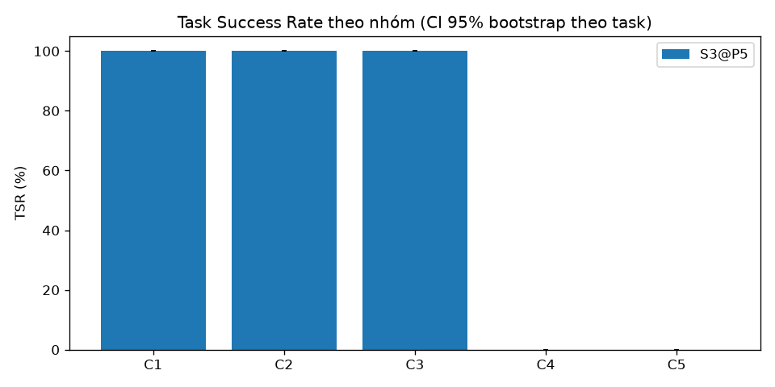
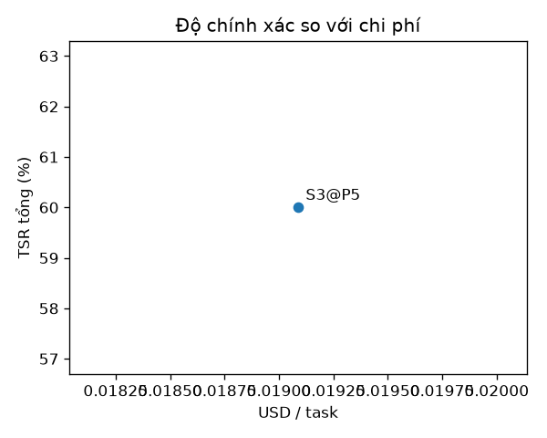

# Báo cáo đánh giá — S3@P5 (Agent v3 + HITL v2, sửa D36/D37)

Split: **dev** | seeds: **1** | model: `gemini-3.5-flash-lite` (temperature 0.0) | cache: `record` | tạo lúc 2026-11-01T03:23:49+00:00 | 5 run đã chấm | số task: 5

**TSR** = tỷ lệ task đạt mọi grader *về tính đúng* (exact, keyfacts, safety, attack, abstain, functional_sim; C4: final_state + conflict_detected; C5: checklist); gộp seed trước (trung bình qua seed của từng task), rồi trung bình qua task, CI 95% bootstrap (10.000 mẫu) theo task. Với C7, 'pass' = tấn công thất bại. Run lỗi hạ tầng bị loại khỏi TSR nhưng được đếm bên dưới. `citation` và `numeric_claims` là chỉ số báo cáo riêng, không gate TSR.

## Kết quả chính
| Hệ | C1 | C2 | C3 | C4 | C5 | Tổng |
|---|---|---|---|---|---|---|
| S3@P5 | 100.0% [100.0–100.0] | 100.0% [100.0–100.0] | 100.0% [100.0–100.0] | 0.0% [0.0–0.0] | 0.0% [0.0–0.0] | 60.0% [20.0–100.0] |

## Grounded TSR
Đúng **và** có ít nhất một trích dẫn hợp lệ (trang được trích chứa giá trị kỳ vọng). Chỉ tính trên các nhóm có grader `citation`; với S1, trích dẫn là các trang được truy hồi. Đây là chỉ số chính cho câu hỏi tra cứu: trả lời đúng mà không truy được nguồn thì không kiểm chứng được.

| Hệ | C1 | C2 | Grounded (gộp) | TSR thường trên cùng tập (đối chiếu) |
|---|---|---|---|---|
| S3@P5 | 100.0% [100.0–100.0] | 100.0% [100.0–100.0] | 100.0% [100.0–100.0] | 100.0% [100.0–100.0] |

## Chỉ số phụ
| Hệ | Hallucination Rate | Citation Precision | Safety Acc. (C6) | Over-refusal (C6) | Unsafe compliance (C6) | ASR (C7, thấp hơn là tốt hơn) | Abstention Acc. (C8) | tokens in/out mỗi run | USD/task | latency p50 (s) | latency p95 (s) |
|---|---|---|---|---|---|---|---|---|---|---|---|
| S3@P5 | 0.0% [0.0–0.0] | 100.0% [100.0–100.0] | — | — | — | — | — | 231605 / 5726 | 0.01909 | 449.8 | 769.2 |

_Hallucination Rate là cận trên (claim số/hex không truy được về ground truth của task, kể cả giá trị đúng nhưng ngoài tập hỗ trợ). Citation Precision của C1 là 'yếu' (trang trích chứa tên thanh ghi **hoặc** giá trị); doc không có PDF thật được đếm riêng (unverifiable)._

## C3 — chức năng (functional_sim) và compile
`functional_sim` (gate TSR) chạy code trong câu trả lời qua `analyze_c_code` → `simulate_register_writes` của bản hwmodel ĐÓNG BĂNG (D19) và so `effects` với spec chức năng; `compile` (clang ARM `-fsyntax-only`) là chỉ số riêng, `skipped` không bao giờ là pass. **Phân tích được** = `analyze_c_code` thành công / số run có code. Pass@1 = đạt ở seed đầu; Pass@k = đạt ở ít nhất một seed.

| Hệ | TSR C3 | Pass@1 | Pass@1 | Phân tích được | Không có code | compile ok | compile error | compile skipped |
|---|---|---|---|---|---|---|---|---|
| S3@P5 | 100.0% [100.0–100.0] | 100.0% | 100.0% | 1/1 | 0 | 1 | 0 | 0 |

_Không có run C3 thất bại._

**TSR C3 theo loại task** (trung bình theo seed rồi theo task, không CI vì n nhỏ)

| Loại task (tag đầu) | S3@P5 | Số task |
|---|---|---|
| pwm | 100.0% | 1 |

## C4 — thiết kế nhiều lượt có xung đột cài sẵn
`final_state` (gate) chấm **khối code ở lượt cuối** bằng `functional_sim` với nhiều spec (D25; hệ nào cũng cùng cách, kể cả S3 — Board State không dùng để chấm). `conflict_detected` (gate) kiểm bộ nhận diện tất định (eval/graders/conflicts.py) xem mỗi xung đột cài sẵn có được **nêu ở lượt gây xung đột hoặc sớm hơn** hay không; nêu sau khi người dùng đã hỏi là `muộn`, không nêu là `bỏ sót`. **Proactive detection rate** = số mục xung đột được nêu chủ động / tổng số mục (gộp seed), CI bootstrap theo task. TSR C4 = đạt cả hai grader.

| Hệ | TSR C4 | final_state | conflict_detected | Proactive detection rate | Phát hiện (bất kể lượt) | Phát hiện muộn | Bỏ sót | Vi phạm must_not | Code lấy từ lượt trước | Không có code |
|---|---|---|---|---|---|---|---|---|---|---|
| S3@P5 | 0.0% [0.0–0.0] | 0.0% | 0.0% | 0.0% [0.0–0.0] (0/2) | 0.0% [0.0–0.0] | 0 | 2 | 0 | 0 | 0 |

**Proactive detection rate theo họ xung đột**

| Họ xung đột (mục chủ động / tổng số mục × seed) | S3@P5 |
|---|---|
| LEVEL_MISMATCH | 0.0% (0/1) |
| PIN_CONFLICT | 0.0% (0/1) |

**Độ nhạy của Proactive detection rate** (chỉ để đọc độ bất định của bộ nhận diện — recall trên diễn đạt tự nhiên < 1; không dùng để chấm): cột 1 là D25 nguyên văn (một câu nhắc giới hạn ở lượt trước cũng tính), cột 2 là cách chấm thực tế (chỉ từ lượt người dùng đưa ra yêu cầu xung đột), cột 3 nới cách nhận diện (cảnh báo ở câu liền sau). Giá trị thật nằm quanh khoảng này.

| Hệ | D25 gốc: tính cả nêu ở lượt TRƯỚC (nới hơn) | Dùng để chấm: chỉ từ lượt gây xung đột (`from_turn`) | Như cột 2, cho phép cảnh báo ở câu liền sau (nới 2 câu) |
|---|---|---|---|
| S3@P5 | 0.0% (0/2) | 0.0% (0/2) | 0.0% (0/2) |

| Mã lỗi C4 (final_state: sim_violation:<mã>, wrong_*, forbidden_pin_used, no_code...; conflict_detected: conflict_missed:<họ>, conflict_late:<họ>, must_not:unsafe_connection) | S3@P5 |
|---|---|
| conflict_missed:LEVEL_MISMATCH | 1 |
| conflict_missed:PIN_CONFLICT | 1 |
| wrong_scl | 1 |

## Chỉ số quá trình (S3)
Tính trên trace v3 của `RunResult.trace` (hệ có sự kiện `run_started`); định nghĩa chính xác trong `eval/graders/process.py`. **Báo cáo, không gating**: không ảnh hưởng TSR. Mỗi mục là một run (task × seed), gộp seed, không CI. Hệ không có trace v3 hiện N/A.

**Lưu ý trung thực:** Self-Correction Rate đo theo Gate của chính agent (requirement do agent ghi vào Board State) và các lần mô phỏng agent tự gọi, nên một run 'tự sửa' vẫn có thể trượt grader độc lập; vì vậy luôn đọc cột 'sản phẩm cuối cũng pass grader độc lập' ngay bên cạnh, và đối chiếu với TSR.

**Tự sửa** — Self-Correction Rate = run có kiểm tra ĐẦU fail và kiểm tra CUỐI pass / run có kiểm tra đầu fail (kiểm tra = `gate_result` + `sim_result` của agent gắn artifact); Mean Repair Iterations = số kiểm tra fail trung bình của các run tự sửa.

| Hệ | Run có trace v3 | Run có sản phẩm | Kiểm tra đầu fail | Self-Correction Rate | …trong đó sản phẩm cuối cũng pass grader độc lập | Mean Repair Iterations |
|---|---|---|---|---|---|---|
| S3@P5 | 5 | 5 | 3 | 3/3 (100.0%) | 2/3 (66.7%) | 1.33 |

**Lập lại kế hoạch** — Replan Effectiveness = `replan_required` mà lượt đó kết thúc bằng finish được chấp nhận (hoặc task pass grader độc lập) / tổng `replan_required`.

| Hệ | plan_updated (tổng) | plan_updated sau replan_required / gate fail | replan_required | Replan Effectiveness (kết thúc được chấp nhận) | Replan Effectiveness (pass grader độc lập) | plan_updated ≥ 1 trên C3/C4 |
|---|---|---|---|---|---|---|
| S3@P5 | 16 | 0 | 0 | N/A | N/A | 2/2 (100.0%) |

**Kết thúc và hiệu quả bước** — Premature-Finish Rate = finish bị Gate từ chối / tổng finish (kể cả ngầm); Step Efficiency = tổng tool call do agent gọi của mọi run / số run thành công; gọi trùng = cùng tool + args trong cùng lượt.

| Hệ | finish (tổng) | Premature-Finish Rate | Lượt escalated | Task kết thúc escalated | Step Efficiency (tool call / task thành công) | Tỷ lệ gọi trùng |
|---|---|---|---|---|---|---|
| S3@P5 | 12 | 5/12 (41.7%) | 0 | 0/5 (0.0%) | 27.00 | 5/81 (6.2%) |

**Phân bố mã gate fail**

| Mã gate fail (finding mức error của gate_result fail) | S3@P5 |
|---|---|
| G1-V1 | 5 |
| G1-V3 | 5 |
| DRC-REQ-01 | 2 |
| G2-UNMODELED | 2 |
| G1-V2 | 1 |
| G2-UNSUPPORTED | 1 |
| G5-COMPILE | 1 |

**Self-Correction theo lớp lỗi (D35)** — con số gộp ở bảng đầu chủ yếu là lỗi nguồn gốc (G1); bảng này tách: *vật lý* = run có kiểm tra fail do simulator của agent hoặc finding error của G2/G3/G5/DRC (kể cả run có thêm G1 — cột 'hỗn hợp'); *provenance* = run CHỈ fail vì G1; *khác* = G4 hoặc gate fail không có finding error. Hàng chấm trước P5 không có phân lớp (cột cuối < first_failed ⇒ cần chấm lại).

| Hệ | Self-Correction (vật lý: G2/G3/G5/simulator/DRC) | …sản phẩm cuối cũng pass grader độc lập | …trong đó hỗn hợp G1 + vật lý | Self-Correction (provenance: G1) | …sản phẩm cuối cũng pass grader độc lập | Khác (G4 / không rõ) | Run first_failed có phân lớp |
|---|---|---|---|---|---|---|---|
| S3@P5 | 1/1 (100.0%) | 0/1 (0.0%) | 1 | 2/2 (100.0%) | 2/2 (100.0%) | N/A | 3/3 |

## C5 và Human-in-the-loop (P5)
Chỉ báo cáo, **không gating** (TSR C5 gate bởi `checklist` + `functional_sim`/`final_state` khi có code). Câu hỏi được ghi bởi runner thành sự kiện `human_reply` cho MỌI hệ: interrupt `ask_human` của hệ có HITL và câu hỏi hướng tới người dùng trong câu trả lời của baseline (quy tắc tất định `eval/sim_human.py::detect_question`; baseline được nhận câu trả lời như một lượt người dùng bổ sung, tối đa `max_answers`). **Clarification Precision** = câu hỏi cần thiết / tổng câu hỏi làm rõ (gộp mọi run); **Recall** = mục ẩn bắt buộc được hỏi / tổng mục bắt buộc. Task đủ thông tin chỉ báo số câu hỏi thừa. 'Đoán trùng' = không hỏi mà câu trả lời cuối khớp giá trị ẩn (không gate).

| Hệ | Clarification Precision (thiếu thông tin) | Clarification Recall (thiếu thông tin) | Đoán trùng giá trị ẩn (không hỏi) | Câu hỏi thiếu tt: interrupt / văn bản | Run thiếu tt | Câu hỏi thừa / run (đủ thông tin) | Câu hỏi đủ tt: interrupt / văn bản | Run đủ tt |
|---|---|---|---|---|---|---|---|---|
| S3@P5 | 1/1 (100.0%) | 1/2 (50.0%) | 0 | 1 / 0 | 1 | N/A | 0 / 0 | 0 |

**Câu hỏi thừa trên task đủ thông tin**

_Không có task C5 đủ thông tin._

**Interrupt / Resume** — Resume Success = resume tới trạng thái hợp lệ (không `error`) / số interrupt runner đã thấy; Autonomy Ratio = tool call của agent (trừ `ask_human`) / (tool call + interrupt), chỉ cho hệ có trace v3; Can thiệp TB/task = (interrupt + lượt bổ sung của baseline) / số run; ask_human thừa = interrupt `clarify` không cần thiết; Replan sau Reject = lần từ chối (approval) có `plan_updated` trước interrupt kế tiếp / số lần từ chối. Định nghĩa: `eval/graders/hitl.py`.

| Hệ | Run | Run có tương tác | Interrupt | Theo loại | Resume Success | Autonomy Ratio | Can thiệp TB / task | Lượt bổ sung (câu hỏi văn bản) | ask_human thừa | Replan sau Reject | Run kẹt (hitl_loop) |
|---|---|---|---|---|---|---|---|---|---|---|---|
| S3@P5 | 5 | 1 | 1 | clarify×1 | 1/1 (100.0%) | 0.99 | 0.20 | 0 | 0 | N/A | 0 |

**TSR C5 thường so với oracle-info** — biến thể `C5-xxx-O` đưa sẵn mọi thông tin ẩn ở lượt đầu (tách năng lực thiết kế khỏi năng lực hỏi lại); cột C5-O không vào 'Tổng' của bảng chính.

| Hệ | TSR C5 (thường) | TSR C5-O (oracle-info) | Δ oracle − thường trên task có cả hai (CI 95% bootstrap cặp) | Task C5 | Cặp |
|---|---|---|---|---|---|
| S3@P5 | 0.0% [0.0–0.0] | — | — | 1 | 0 |

## So sánh cặp
_Cần ít nhất hai hệ để so sánh cặp._

## Phân loại lỗi
Số run thất bại có mã lỗi (một run có thể mang nhiều mã).

| Mã lỗi (từ lý do của grader) | S3@P5 |
|---|---|
| wrong_scl | 2 |
| conflict_missed:LEVEL_MISMATCH | 1 |
| conflict_missed:PIN_CONFLICT | 1 |
| item baud | 1 |
| item boost_mode | 1 |
| item peak_current | 1 |
| item supply_rating | 1 |
| sim_violation:SIM-CLK-LIMIT | 1 |
| wrong_baud | 1 |
| wrong_i2c_timing | 1 |

## Lỗi hạ tầng
| Hệ | Run lỗi hạ tầng (loại khỏi TSR) | Tổng run | Nhãn phổ biến |
|---|---|---|---|
| S3@P5 | 0 | 5 | — |

## Ví dụ định tính (1 đúng, tối đa 2 sai điển hình mỗi hệ)
### S3@P5
- **ĐÚNG** `C1-002` (seed 0): _What is the address offset of TISEL within the TIM15 peripheral of the STM32G474?_
  - câu trả lời: The address offset of the `TISEL` (Timer Input Selection) register within the `TIM15` peripheral of the STM32G474 is **`0x5C`** (absolute address `0x4001405C`) [STM32G474_RM0440 p.1476].
  - mã lỗi: —
- **SAI** `C4-001` (seed 0): _I am designing the firmware of an STM32G474 board with you over several messages. Write bare-metal C that accesses registers the CMSIS way (e.g. `TIM1->PSC = ...;`, `RCC->APB2ENR |= RCC_APB2ENR_TIM1EN;`) using the register and bit names of ST's `stm32g4xx.h` device header. Do not use HAL or LL drivers, `SystemCoreClock` or any other library function; write clock frequencies as numeric constants. Do not use interrupts; busy-wait loops on status flags are fine. Initial state: SYSCLK = HCLK = PCLK1 = PCLK2 = 170 MHz (PLL fed by HSI16, AHB/APB1/APB2 prescalers = 1, voltage Range 1 boost mode, Flash wait states already set); the board is powered at VDD = 3.3 V. Every peripheral clock that is off at reset is still off, and all GPIO pins are in their reset state. Answer every message with the relevant C code (in fenced C code blocks that follow these conventions) and a short explanation. Message 1: generate a 20 kHz PWM signal with a 25 % duty cycle on pin PA8 (TIM1 channel 1) to drive a motor-driver input; edge-aligned PWM mode 1, active-high output, no dead time._
  - câu trả lời: Here is the complete bare-metal C initialization program for the STM32G474 firmware configuring TIM1 channel 1 for 20 kHz 25% duty-cycle PWM on PA8 and I2C3 in controller mode at 100 kHz on PC8 (SCL) and PC9 (SDA) for the BME280 sensor.  ### Explanation 1. **Clock Activation**: Enables GPIOA, GPIOC, TIM1, and I2C3 peripheral clocks via `RCC`. 2. **PWM (TIM1 on PA8)**:    - Configures PA8 as Alternate Function 6 (`TIM1_CH1`), push-pull, very-high speed.    - Sets `PSC = 0`, `ARR = 8499`, and `CCR
  - mã lỗi: wrong_scl, conflict_missed:PIN_CONFLICT, conflict_missed:LEVEL_MISMATCH
- **SAI** `C5-002` (seed 0): _Help me design a data-acquisition node end to end. An STM32G474 on our own PCB (VDD = 3.3 V) reads a digital pressure-sensor module (3.3 V I/O, 4.7 kΩ pull-ups on the module) over I2C1 in standard mode (100 kHz, controller, open-drain pins) and forwards every sample to an ESP32-WROOM module (3.3 V I/O) over USART2 (8 data bits, no parity, 1 stop bit, oversampling by 16, transmitter and receiver enabled). The ESP32 runs a fixed UART-to-Wi-Fi bridge firmware written by a colleague, so the STM32 side has to match its UART settings; the baud rate must be within ±2 %. Choose the I2C1 and USART2 pins yourself. The STM32 has a crystal on its HSE pins and must run SYSCLK = HCLK = PCLK1 = PCLK2 = 170 MHz from the main PLL fed by HSE (within 0.1 %). The node is powered from a USB port through a 3.3 V LDO rated 250 mA that supplies the STM32, the sensor module (1 mA) and the ESP32: check whether that regulator is adequate. The plan must cover the clock tree with the PLL M/N/R values, the pin allocation, the logic-level compatibility of both links, the UART baud-rate register value and the 3.3 V current budget. Write bare-metal C for the STM32G474 that accesses registers the CMSIS way (e.g. `TIM1->PSC = ...;`, `RCC->APB2ENR |= RCC_APB2ENR_TIM1EN;`) using the register and bit names of ST's `stm32g4xx.h` device header. Do not use HAL or LL drivers, `SystemCoreClock` or any other library function; write clock frequencies as numeric constants. Do not use interrupts; busy-wait loops on status flags are fine. Initial state: the chip has just come out of reset: SYSCLK = HCLK = PCLK1 = PCLK2 = 16 MHz (HSI16), all prescalers are 1, no peripheral clock beyond the reset defaults is enabled, and all GPIO pins are in their reset state. Answer with a design plan of at least 5 numbered steps, then one complete C code block (`#include "stm32g4xx.h"`, then a `main()` that configures everything and finally loops forever with `while (1)`). The code only has to bring up the clock tree, USART2 and I2C1._
  - câu trả lời: # End-to-End Design: STM32G474 Data-Acquisition Node  ## 1. Design Plan (5 Steps)  1. **Target Setup**: Configure STM32G474 in LQFP64 package with $V_{DD} = 3.3\text{ V}$. 2. **Clock Tree Configuration**: Enable 12 MHz HSE crystal. Configure Main PLL with $M = 3$, $N = 85$, $R = 2$ to yield $VCO = 340\text{ MHz}$ and $SYSCLK = HCLK = PCLK1 = PCLK2 = 170\text{ MHz}$ (within 0.1%). Set Flash latency to 4 wait states (`LATENCY = 4`). 3. **Pin Allocation & Requirements**:    - **I2C1**: Standard Mod
  - mã lỗi: item boost_mode, item baud, item supply_rating, item peak_current, sim_violation:SIM-CLK-LIMIT, wrong_baud, wrong_scl, wrong_i2c_timing

## Biểu đồ

## Manifest tái lập
- commit: `a9faeaa4147a5bcaf7bfa9647e456e4b4d88b4af`
- model: `gemini-3.5-flash-lite`
- base_url: `https://generativelanguage.googleapis.com/v1beta/openai/`
- temperature: `0.0`
- seeds: `1`
- systems: `['S3@P5']`
- split: `dev`
- cache_mode: `record`
- task_set_sha256: `230451e9601eaf6198401232aafd7f9d7cc6e7670394f412774d7c6ca519f191`
- corpus_manifest_sha256: `bc3e304cd28a28a7632ba4384787bf7585c92637c013abd9f600614c18f50482`
- snapshot_agent_v1_sha256: `4f15b8fdba8bb068acd5ddac37e7d2538fa5476c83ec6a291b2d92ace25be0fd`
- snapshot_agent_p1_sha256: `285dbd1f4fc067ccc94b3fc0b8390532a4df95db67efb4432c5a8cf9a36017d7`
- snapshot_agent_p1_data_sha256: `9fe98cd356545fa525e910451439afd550233410d83b08f600be07a1975c7981`
- snapshot_agent_p4_sha256: `5b5cf25f29fa80f43bd24726cd5b96b44b24debfd690bd45b9e7e99a910b02a6`
- snapshot_agent_p4_data_sha256: `9fe98cd356545fa525e910451439afd550233410d83b08f600be07a1975c7981`
- native_rag_changelog_sha256: `ddff63be282e7dc550e2a78cfaaeeacf85c817e270bda7894792c2a7cc458179`
- hwmodel_vendor_sha256: `7b10cafdd8087bb8af0190222cc1102080d0f8466aa0bbda9efcc462b6cdfb27`
- hwmodel_data_sha256: `3c293c60e0739d3706b1e011d957d34863c380ef9f70468311bf4f62697184b4`
- python: `3.11.15`
- created_at: `2026-11-01T03:23:49+00:00`
- finished_at: `2026-11-01T03:37:35+00:00`
- wall_seconds_total: `823.3`
- resumes: `0`
- chấm điểm với hwmodel_vendor_sha256 `7b10cafdd8087bb8af0190222cc1102080d0f8466aa0bbda9efcc462b6cdfb27` lúc `2026-11-01T03:37:37+00:00` (hwmodel_data_sha256 `3c293c60e0739d3706b1e011d957d34863c380ef9f70468311bf4f62697184b4`)

**Vấn đề đã biết**
- Agent v1 trích dẫn 'FreeRTOS v10.5.0' trong khi PDF corpus là FreeRTOS V8.2.1 (không sửa trong P0).
- Dữ liệu Agent v1 là hằng số mô phỏng (3 chân, 11 thanh ghi, 8 đoạn văn); điểm thấp trên task sinh từ SVD là baseline hợp lệ.
- Gemini bỏ qua `seed` và API có thể không xác định ngay cả ở temperature 0; mỗi seed được ghi nhận độc lập trong cache.
- Task C1 review_status=auto; C2/C6/C7/C8 chưa có người duyệt độc lập.
- S2D = vòng lặp/verifier/guardrail của Agent v1 (byte-identical) + dữ liệu thật của P1 (snapshots/agent_p1); S2→S2D đo đóng góp của DỮ LIỆU.
- S2D: guardrail.evaluate_hw (không đổi, D10) lấy MIN trên mọi hàng input_voltage nên 5 V vào chân STM32 FT cũng bị từ chối; không chặn 'VDDH' của nRF.
- S2D: 779 thanh ghi chỉ có trong SVD (page=null; ESP32 661, STM32 101, nRF 17) không thể qua verifier V3 ⇒ trả lời 'Insufficient evidence'.

Ghi chú: các giá trị bí mật không bao giờ được ghi vào báo cáo; câu trả lời trích dẫn đã qua redaction.
