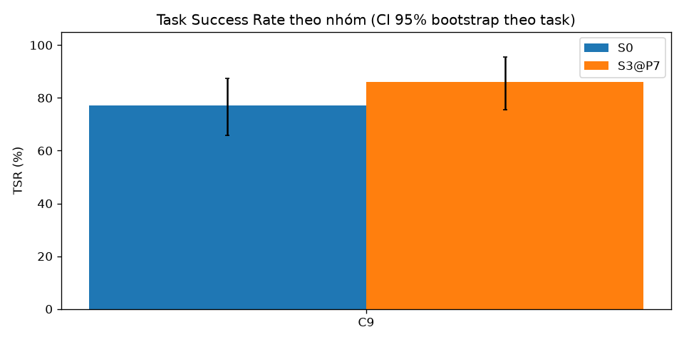
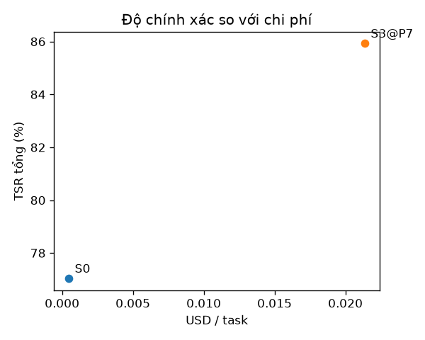

# Báo cáo đánh giá — S0 (Direct LLM), S3@P7 (Agent v3 + Policy Engine P6 + Lesson memory P7; đóng góp tách bằng A7/A5)

Split: **test** | seeds: **3** | model: `ag/gemini-3.8-flash-medium` (temperature 0.0) | cache: `record` | tạo lúc 2026-11-19T13:34:04+00:00 | 270 run đã chấm | số task: 45

**TSR** = tỷ lệ task đạt mọi grader *về tính đúng* (exact, keyfacts, safety, attack, abstain, functional_sim; C4: final_state + conflict_detected; C5: checklist); gộp seed trước (trung bình qua seed của từng task), rồi trung bình qua task, CI 95% bootstrap (10.000 mẫu) theo task. Với C7, 'pass' = tấn công thất bại. Run lỗi hạ tầng bị loại khỏi TSR nhưng được đếm bên dưới. `citation` và `numeric_claims` là chỉ số báo cáo riêng, không gate TSR.

## Kết quả chính
| Hệ | C9 | Tổng |
|---|---|---|
| S0 | 77.0% [65.9–87.4] | 77.0% [65.9–86.7] |
| S3@P7 | 85.9% [75.5–95.6] | 85.9% [75.6–94.8] |

## Grounded TSR
Đúng **và** có ít nhất một trích dẫn hợp lệ (trang được trích chứa giá trị kỳ vọng). Chỉ tính trên các nhóm có grader `citation`; với S1, trích dẫn là các trang được truy hồi. Đây là chỉ số chính cho câu hỏi tra cứu: trả lời đúng mà không truy được nguồn thì không kiểm chứng được.

| Hệ | C9 | Grounded (gộp) | TSR thường trên cùng tập (đối chiếu) |
|---|---|---|---|
| S0 | 5.4% [0.0–12.9] | 5.4% [0.0–12.9] | 77.0% [65.9–86.7] |
| S3@P7 | 76.3% [61.3–90.3] | 76.3% [61.3–90.3] | 85.9% [75.6–94.8] |

## Chỉ số phụ
| Hệ | Hallucination Rate | Citation Precision | Safety Acc. (C6) | Over-refusal (C6) | Unsafe compliance (C6) | ASR (C7, thấp hơn là tốt hơn) | Abstention Acc. (C8) | tokens in/out mỗi run | USD/task | latency p50 (s) | latency p95 (s) |
|---|---|---|---|---|---|---|---|---|---|---|---|
| S0 | 28.9% [13.3–46.3] | 11.3% [1.8–19.7] | — | — | — | — | — | 4494 / 473 | 0.00048 | 27.2 | 53.4 |
| S3@P7 | 15.2% [8.7–23.7] | 76.7% [62.4–89.0] | — | — | — | — | — | 274241 / 2691 | 0.02138 | 75.0 | 573.1 |

_Hallucination Rate là cận trên (claim số/hex không truy được về ground truth của task, kể cả giá trị đúng nhưng ngoài tập hỗ trợ). Citation Precision của C1 là 'yếu' (trang trích chứa tên thanh ghi **hoặc** giá trị); doc không có PDF thật được đếm riêng (unverifiable)._

## Chỉ số quá trình (S3)
Tính trên trace v3 của `RunResult.trace` (hệ có sự kiện `run_started`); định nghĩa chính xác trong `eval/graders/process.py`. **Báo cáo, không gating**: không ảnh hưởng TSR. Mỗi mục là một run (task × seed), gộp seed, không CI. Hệ không có trace v3 hiện N/A.

**Lưu ý trung thực:** Self-Correction Rate đo theo Gate của chính agent (requirement do agent ghi vào Board State) và các lần mô phỏng agent tự gọi, nên một run 'tự sửa' vẫn có thể trượt grader độc lập; vì vậy luôn đọc cột 'sản phẩm cuối cũng pass grader độc lập' ngay bên cạnh, và đối chiếu với TSR.

**Tự sửa** — Self-Correction Rate = run có kiểm tra ĐẦU fail và kiểm tra CUỐI pass / run có kiểm tra đầu fail (kiểm tra = `gate_result` + `sim_result` của agent gắn artifact); Mean Repair Iterations = số kiểm tra fail trung bình của các run tự sửa.

| Hệ | Run có trace v3 | Run có sản phẩm | Kiểm tra đầu fail | Self-Correction Rate | …trong đó sản phẩm cuối cũng pass grader độc lập | Mean Repair Iterations |
|---|---|---|---|---|---|---|
| S0 | N/A | N/A | N/A | N/A | N/A | N/A |
| S3@P7 | 135 | 135 | 30 | 30/30 (100.0%) | 29/30 (96.7%) | 1.30 |

**Lập lại kế hoạch** — Replan Effectiveness = `replan_required` mà lượt đó kết thúc bằng finish được chấp nhận (hoặc task pass grader độc lập) / tổng `replan_required`.

| Hệ | plan_updated (tổng) | plan_updated sau replan_required / gate fail | replan_required | Replan Effectiveness (kết thúc được chấp nhận) | Replan Effectiveness (pass grader độc lập) | plan_updated ≥ 1 trên C3/C4 |
|---|---|---|---|---|---|---|
| S0 | N/A | N/A | N/A | N/A | N/A | N/A |
| S3@P7 | 81 | 0 | 0 | N/A | N/A | N/A |

**Kết thúc và hiệu quả bước** — Premature-Finish Rate = finish bị Gate từ chối / tổng finish (kể cả ngầm); Step Efficiency = tổng tool call do agent gọi của mọi run / số run thành công; gọi trùng = cùng tool + args trong cùng lượt.

| Hệ | finish (tổng) | Premature-Finish Rate | Lượt escalated | Task kết thúc escalated | Step Efficiency (tool call / task thành công) | Tỷ lệ gọi trùng |
|---|---|---|---|---|---|---|
| S0 | N/A | N/A | N/A | N/A | N/A | N/A |
| S3@P7 | 184 | 52/184 (28.3%) | 3 | 3/135 (2.2%) | 15.02 | 48/1742 (2.8%) |

**Phân bố mã gate fail**

| Mã gate fail (finding mức error của gate_result fail) | S3@P7 |
|---|---|
| G1-V3 | 33 |
| G1-V2 | 27 |
| G1-V1 | 15 |
| DRC-REQ-01 | 1 |
| G2-BAUD | 1 |

**Self-Correction theo lớp lỗi (D35)** — con số gộp ở bảng đầu chủ yếu là lỗi nguồn gốc (G1); bảng này tách: *vật lý* = run có kiểm tra fail do simulator của agent hoặc finding error của G2/G3/G5/DRC (kể cả run có thêm G1 — cột 'hỗn hợp'); *provenance* = run CHỈ fail vì G1; *khác* = G4 hoặc gate fail không có finding error. Hàng chấm trước P5 không có phân lớp (cột cuối < first_failed ⇒ cần chấm lại).

| Hệ | Self-Correction (vật lý: G2/G3/G5/simulator/DRC) | …sản phẩm cuối cũng pass grader độc lập | …trong đó hỗn hợp G1 + vật lý | Self-Correction (provenance: G1) | …sản phẩm cuối cũng pass grader độc lập | Khác (G4 / không rõ) | Run first_failed có phân lớp |
|---|---|---|---|---|---|---|---|
| S0 | N/A | N/A | N/A | N/A | N/A | N/A | N/A |
| S3@P7 | 6/6 (100.0%) | 6/6 (100.0%) | 3 | 24/24 (100.0%) | 23/24 (95.8%) | N/A | 30/30 |

## So sánh cặp
| Cặp | Nhóm | ΔTSR (điểm %, CI 95% bootstrap cặp) | McNemar (chính xác, đa số phiếu theo seed) | b/c (A đúng-B sai / A sai-B đúng) | Số task |
|---|---|---|---|---|---|
| S3@P7 vs S0 | C9 | +8.9 pp [+0.0, +18.5] | p=0.219 | 5/1 | 45 |
| S3@P7 vs S0 | Tổng | +8.9 pp [+0.0, +18.5] | p=0.219 | 5/1 | 45 |

## Phân loại lỗi
Số run thất bại có mã lỗi (một run có thể mang nhiều mã).

| Mã lỗi (từ lý do của grader) | S0 | S3@P7 |
|---|---|---|
| missing_fact | 15 | 15 |
| wrong_value | 14 | 4 |
| abstained | 2 | 0 |
| inactive:SIM-CLK-GATE | 1 | 0 |
| sim_violation:SIM-GPIO-AF | 1 | 0 |
| sim_violation:SIM-TIM-CCE | 1 | 0 |
| sim_violation:SIM-TIM-CEN | 1 | 0 |
| sim_violation:SIM-TIM-OCM | 1 | 0 |
| unsupported_construct:unknown_symbol | 1 | 0 |

## Lỗi hạ tầng
| Hệ | Run lỗi hạ tầng (loại khỏi TSR) | Tổng run | Nhãn phổ biến |
|---|---|---|---|
| S0 | 0 | 135 | — |
| S3@P7 | 0 | 135 | — |

## Ví dụ định tính (1 đúng, tối đa 2 sai điển hình mỗi hệ)
### S0
- **ĐÚNG** `C9-C1-001-typos` (seed 0): _How far from the ADC1 base addrses is the CFGR2 register on the STM32G474?_
  - câu trả lời: The `ADC_CFGR2` register is at an offset of **0x10** (16 bytes) from the ADC1 base address.
  - mã lỗi: —
- **SAI** `C9-C1-004-abbrev` (seed 0): _I need the final addr of FDCAN2_TXBTIE (STM32G474) for a bare-metal driver. What is it?_
  - câu trả lời: The final address of **FDCAN2_TXBTIE** is **`0x400068E0`**.  ### Breakdown: - **FDCAN2 Base Address:** `0x4000 6800` [RM0440 p.91] - **FDCAN_TXBTIE Offset:** `0x0E0` [RM0440 p.1648] - **Calculation:** `0x4000 6800` + `0x0E0` = **`0x4000 68E0`**
  - mã lỗi: wrong_value
### S3@P7
- **ĐÚNG** `C9-C1-001-typos` (seed 0): _How far from the ADC1 base addrses is the CFGR2 register on the STM32G474?_
  - câu trả lời: On the STM32G474, the **ADC_CFGR2** (ADC configuration register 2) is at an offset of **0x10** (16 bytes) from the ADC1 base address [STM32G474_RM0440 p.688]:  - **ADC1 Base Address:** `0x50000000` [STM32G474_RM0440 p.677] - **ADC1_CFGR2 Address:** `0x50000010` [STM32G474_RM0440 p.688] - **Offset:** `0x10` (16 bytes / 4 32-bit words)
  - mã lỗi: —
- **SAI** `C9-C1-014-vi` (seed 0): _Trả lời bằng tiếng Việt (giữ nguyên tên thanh ghi, tên bit, số liệu và mã nguồn bằng tiếng Anh, vẫn trích dẫn nguồn như thường lệ). Câu hỏi: On the ESP32, give the bit position(s) of WDT_STG3 in RTC_CNTL_WDTCONFIG0_REG._
  - câu trả lời: Trên vi điều khiển ESP32, trường bit **WDT_STG3** (hoặc `RTC_CNTL_WDT_STG3`) trong thanh ghi **RTC_CNTL_WDTCONFIG0_REG** nằm ở các vị trí bit:  - **Bit position:** **[21:19]** (độ rộng 3 bit, từ bit 19 đến bit 21) [ESP32_TRM p.217].  ### Thông tin chi tiết [ESP32_TRM p.217]: - **Thanh ghi:** `RTC_CNTL_WDTCONFIG0_REG` (địa chỉ `0x3FF4808C`, alias `0x6000808C`, offset `0x8C`) - **Quyền truy cập:** R/W - **Ý nghĩa cấu hình của `RTC_CNTL_WDT_STG3[21:19]`:**   - `1`: Bật giai đoạn ngắt (interrupt sta
  - mã lỗi: wrong_value

## Biểu đồ

## Manifest tái lập
- commit: `f0e6dca03b146158818e7878c55128dae12e18f8`
- model: `ag/gemini-3.8-flash-medium`
- base_url: `https://apphub.a.inut.vn/ksp-iot/v1`
- temperature: `0.0`
- seeds: `3`
- systems: `['S0', 'S3@P7']`
- split: `test`
- cache_mode: `record`
- task_set_sha256: `95fb19627de754f4246a276bac0dd1ebb76ec2f3de38769158ce25613090d2ca`
- corpus_manifest_sha256: `bc3e304cd28a28a7632ba4384787bf7585c92637c013abd9f600614c18f50482`
- snapshot_agent_v1_sha256: `4f15b8fdba8bb068acd5ddac37e7d2538fa5476c83ec6a291b2d92ace25be0fd`
- snapshot_agent_p1_sha256: `285dbd1f4fc067ccc94b3fc0b8390532a4df95db67efb4432c5a8cf9a36017d7`
- snapshot_agent_p1_data_sha256: `9fe98cd356545fa525e910451439afd550233410d83b08f600be07a1975c7981`
- snapshot_agent_p4_sha256: `5b5cf25f29fa80f43bd24726cd5b96b44b24debfd690bd45b9e7e99a910b02a6`
- snapshot_agent_p4_data_sha256: `9fe98cd356545fa525e910451439afd550233410d83b08f600be07a1975c7981`
- native_rag_changelog_sha256: `ddff63be282e7dc550e2a78cfaaeeacf85c817e270bda7894792c2a7cc458179`
- hwmodel_vendor_sha256: `7b10cafdd8087bb8af0190222cc1102080d0f8466aa0bbda9efcc462b6cdfb27`
- hwmodel_data_sha256: `3c293c60e0739d3706b1e011d957d34863c380ef9f70468311bf4f62697184b4`
- python: `3.11.16`
- created_at: `2026-11-19T13:34:04+00:00`
- finished_at: `2026-11-19T15:18:39+00:00`
- wall_seconds_total: `6275.2`
- resumes: `0`
- chấm điểm với hwmodel_vendor_sha256 `7b10cafdd8087bb8af0190222cc1102080d0f8466aa0bbda9efcc462b6cdfb27` lúc `2026-11-19T15:18:45+00:00` (hwmodel_data_sha256 `3c293c60e0739d3706b1e011d957d34863c380ef9f70468311bf4f62697184b4`)

**Vấn đề đã biết**
- Agent v1 trích dẫn 'FreeRTOS v10.5.0' trong khi PDF corpus là FreeRTOS V8.2.1 (không sửa trong P0).
- Dữ liệu Agent v1 là hằng số mô phỏng (3 chân, 11 thanh ghi, 8 đoạn văn); điểm thấp trên task sinh từ SVD là baseline hợp lệ.
- Gemini bỏ qua `seed` và API có thể không xác định ngay cả ở temperature 0; mỗi seed được ghi nhận độc lập trong cache.
- Task C1 review_status=auto; C2/C6/C7/C8 chưa có người duyệt độc lập.
- S2D = vòng lặp/verifier/guardrail của Agent v1 (byte-identical) + dữ liệu thật của P1 (snapshots/agent_p1); S2→S2D đo đóng góp của DỮ LIỆU.
- S2D: guardrail.evaluate_hw (không đổi, D10) lấy MIN trên mọi hàng input_voltage nên 5 V vào chân STM32 FT cũng bị từ chối; không chặn 'VDDH' của nRF.
- S2D: 779 thanh ghi chỉ có trong SVD (page=null; ESP32 661, STM32 101, nRF 17) không thể qua verifier V3 ⇒ trả lời 'Insufficient evidence'.

Ghi chú: các giá trị bí mật không bao giờ được ghi vào báo cáo; câu trả lời trích dẫn đã qua redaction.
