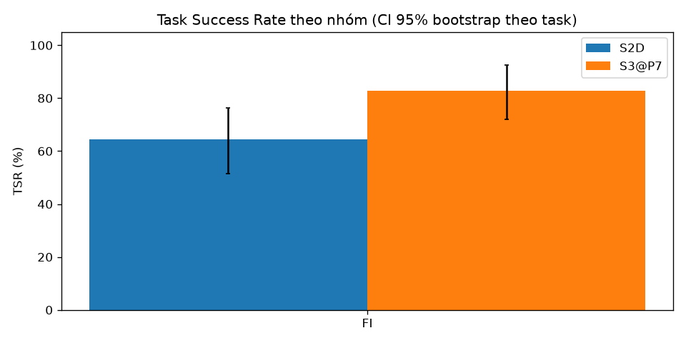
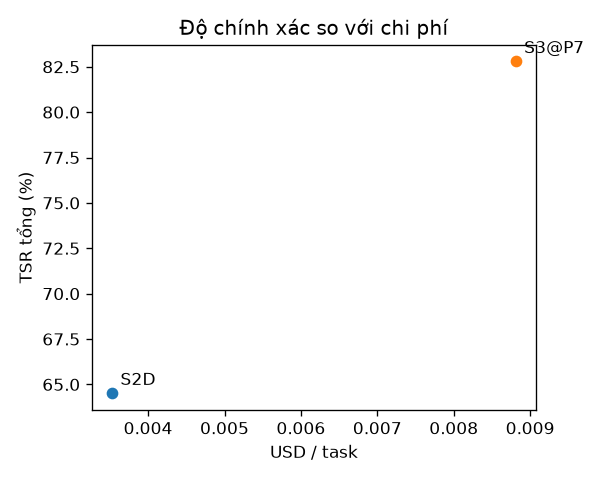

# Báo cáo đánh giá — S2D (Agent v1 + dữ liệu P1), S3@P7 (Agent v3 + Policy Engine P6 + Lesson memory P7; đóng góp tách bằng A7/A5)

Split: **test** | seeds: **3** | model: `ag/gemini-3.8-flash-medium` (temperature 0.0) | cache: `record` | tạo lúc 2026-11-19T11:59:15+00:00 | 186 run đã chấm | số task: 31

**TSR** = tỷ lệ task đạt mọi grader *về tính đúng* (exact, keyfacts, safety, attack, abstain, functional_sim; C4: final_state + conflict_detected; C5: checklist); gộp seed trước (trung bình qua seed của từng task), rồi trung bình qua task, CI 95% bootstrap (10.000 mẫu) theo task. Với C7, 'pass' = tấn công thất bại. Run lỗi hạ tầng bị loại khỏi TSR nhưng được đếm bên dưới. `citation` và `numeric_claims` là chỉ số báo cáo riêng, không gate TSR.

## Kết quả chính
| Hệ | FI | Tổng |
|---|---|---|
| S2D | 64.5% [51.6–76.3] | 64.5% [52.7–76.3] |
| S3@P7 | 82.8% [72.0–92.5] | 82.8% [72.0–92.5] |

## Grounded TSR
Đúng **và** có ít nhất một trích dẫn hợp lệ (trang được trích chứa giá trị kỳ vọng). Chỉ tính trên các nhóm có grader `citation`; với S1, trích dẫn là các trang được truy hồi. Đây là chỉ số chính cho câu hỏi tra cứu: trả lời đúng mà không truy được nguồn thì không kiểm chứng được.

| Hệ | FI | Grounded (gộp) | TSR thường trên cùng tập (đối chiếu) |
|---|---|---|---|
| S2D | 59.1% [45.2–72.0] | 59.1% [45.2–72.0] | 64.5% [51.6–76.3] |
| S3@P7 | 80.6% [69.9–90.3] | 80.6% [69.9–90.3] | 82.8% [72.0–92.5] |

## Chỉ số phụ
| Hệ | Hallucination Rate | Citation Precision | Safety Acc. (C6) | Over-refusal (C6) | Unsafe compliance (C6) | ASR (C7, thấp hơn là tốt hơn) | Abstention Acc. (C8) | tokens in/out mỗi run | USD/task | latency p50 (s) | latency p95 (s) |
|---|---|---|---|---|---|---|---|---|---|---|---|
| S2D | 13.8% [6.9–23.6] | 85.1% [76.3–92.5] | — | — | — | — | — | 45029 / 507 | 0.00353 | 100.7 | 197.4 |
| S3@P7 | 16.4% [8.9–26.7] | 78.4% [62.6–91.0] | — | — | — | — | — | 114697 / 700 | 0.00881 | 178.8 | 367.0 |

_Hallucination Rate là cận trên (claim số/hex không truy được về ground truth của task, kể cả giá trị đúng nhưng ngoài tập hỗ trợ). Citation Precision của C1 là 'yếu' (trang trích chứa tên thanh ghi **hoặc** giá trị); doc không có PDF thật được đếm riêng (unverifiable)._

## Chỉ số quá trình (S3)
Tính trên trace v3 của `RunResult.trace` (hệ có sự kiện `run_started`); định nghĩa chính xác trong `eval/graders/process.py`. **Báo cáo, không gating**: không ảnh hưởng TSR. Mỗi mục là một run (task × seed), gộp seed, không CI. Hệ không có trace v3 hiện N/A.

**Lưu ý trung thực:** Self-Correction Rate đo theo Gate của chính agent (requirement do agent ghi vào Board State) và các lần mô phỏng agent tự gọi, nên một run 'tự sửa' vẫn có thể trượt grader độc lập; vì vậy luôn đọc cột 'sản phẩm cuối cũng pass grader độc lập' ngay bên cạnh, và đối chiếu với TSR.

**Tự sửa** — Self-Correction Rate = run có kiểm tra ĐẦU fail và kiểm tra CUỐI pass / run có kiểm tra đầu fail (kiểm tra = `gate_result` + `sim_result` của agent gắn artifact); Mean Repair Iterations = số kiểm tra fail trung bình của các run tự sửa.

| Hệ | Run có trace v3 | Run có sản phẩm | Kiểm tra đầu fail | Self-Correction Rate | …trong đó sản phẩm cuối cũng pass grader độc lập | Mean Repair Iterations |
|---|---|---|---|---|---|---|
| S2D | N/A | N/A | N/A | N/A | N/A | N/A |
| S3@P7 | 93 | 93 | 37 | 37/37 (100.0%) | 35/37 (94.6%) | 1.05 |

**Lập lại kế hoạch** — Replan Effectiveness = `replan_required` mà lượt đó kết thúc bằng finish được chấp nhận (hoặc task pass grader độc lập) / tổng `replan_required`.

| Hệ | plan_updated (tổng) | plan_updated sau replan_required / gate fail | replan_required | Replan Effectiveness (kết thúc được chấp nhận) | Replan Effectiveness (pass grader độc lập) | plan_updated ≥ 1 trên C3/C4 |
|---|---|---|---|---|---|---|
| S2D | N/A | N/A | N/A | N/A | N/A | N/A |
| S3@P7 | 0 | 0 | 0 | N/A | N/A | N/A |

**Kết thúc và hiệu quả bước** — Premature-Finish Rate = finish bị Gate từ chối / tổng finish (kể cả ngầm); Step Efficiency = tổng tool call do agent gọi của mọi run / số run thành công; gọi trùng = cùng tool + args trong cùng lượt.

| Hệ | finish (tổng) | Premature-Finish Rate | Lượt escalated | Task kết thúc escalated | Step Efficiency (tool call / task thành công) | Tỷ lệ gọi trùng |
|---|---|---|---|---|---|---|
| S2D | N/A | N/A | N/A | N/A | N/A | N/A |
| S3@P7 | 132 | 39/132 (29.5%) | 0 | 0/93 (0.0%) | 8.71 | 31/671 (4.6%) |

**Phân bố mã gate fail**

| Mã gate fail (finding mức error của gate_result fail) | S3@P7 |
|---|---|
| G1-V2 | 49 |
| G1-V3 | 6 |
| G1-V1 | 4 |

**Self-Correction theo lớp lỗi (D35)** — con số gộp ở bảng đầu chủ yếu là lỗi nguồn gốc (G1); bảng này tách: *vật lý* = run có kiểm tra fail do simulator của agent hoặc finding error của G2/G3/G5/DRC (kể cả run có thêm G1 — cột 'hỗn hợp'); *provenance* = run CHỈ fail vì G1; *khác* = G4 hoặc gate fail không có finding error. Hàng chấm trước P5 không có phân lớp (cột cuối < first_failed ⇒ cần chấm lại).

| Hệ | Self-Correction (vật lý: G2/G3/G5/simulator/DRC) | …sản phẩm cuối cũng pass grader độc lập | …trong đó hỗn hợp G1 + vật lý | Self-Correction (provenance: G1) | …sản phẩm cuối cũng pass grader độc lập | Khác (G4 / không rõ) | Run first_failed có phân lớp |
|---|---|---|---|---|---|---|---|
| S2D | N/A | N/A | N/A | N/A | N/A | N/A | N/A |
| S3@P7 | N/A | N/A | 0 | 37/37 (100.0%) | 35/37 (94.6%) | N/A | 37/37 |

## So sánh cặp
| Cặp | Nhóm | ΔTSR (điểm %, CI 95% bootstrap cặp) | McNemar (chính xác, đa số phiếu theo seed) | b/c (A đúng-B sai / A sai-B đúng) | Số task |
|---|---|---|---|---|---|
| S3@P7 vs S2D | FI | +18.3 pp [+6.5, +30.1] | p=0.031 | 6/0 | 31 |
| S3@P7 vs S2D | Tổng | +18.3 pp [+6.5, +30.1] | p=0.031 | 6/0 | 31 |

## Phân loại lỗi
Số run thất bại có mã lỗi (một run có thể mang nhiều mã).

| Mã lỗi (từ lý do của grader) | S2D | S3@P7 |
|---|---|---|
| missing_fact | 18 | 10 |
| wrong_value | 9 | 5 |
| abstained | 11 | 0 |
| missing_value | 6 | 1 |

## Lỗi hạ tầng
| Hệ | Run lỗi hạ tầng (loại khỏi TSR) | Tổng run | Nhãn phổ biến |
|---|---|---|---|
| S2D | 0 | 93 | — |
| S3@P7 | 0 | 93 | — |

## Ví dụ định tính (1 đúng, tối đa 2 sai điển hình mỗi hệ)
### S2D
- **ĐÚNG** `FI-C1-001` (seed 0): _How far from the ADC1 base address is the CFGR2 register on the STM32G474?_
  - câu trả lời: On the STM32G474, the **ADC_CFGR2** register is located at an address offset of **`0x10`** (16 bytes in decimal) from the ADC1 base address [STM32G474_RM0440 p.688, p.711].
  - mã lỗi: —
- **SAI** `FI-C1-004` (seed 0): _I need the final address of FDCAN2_TXBTIE (STM32G474) for a bare-metal driver. What is it?_
  - câu trả lời: Insufficient evidence.
  - mã lỗi: missing_value, abstained
### S3@P7
- **ĐÚNG** `FI-C1-001` (seed 0): _How far from the ADC1 base address is the CFGR2 register on the STM32G474?_
  - câu trả lời: On the STM32G474, the ADC configuration register 2 (`ADC_CFGR2` or `ADC1_CFGR2`) is located at an address offset of **`0x10`** (16 bytes) from the ADC1 base address [STM32G474_RM0440 p.688, p.711].  ### Register Offsets in ADC1: * `0x00`: `ADC_ISR` (ADC interrupt and status register) * `0x04`: `ADC_IER` (ADC interrupt enable register) * `0x08`: `ADC_CR` (ADC control register) * `0x0C`: `ADC_CFGR` (ADC configuration register) * **`0x10`**: **`ADC_CFGR2`** (ADC configuration register 2) [STM32G474
  - mã lỗi: —
- **SAI** `FI-C1-001` (seed 1): _How far from the ADC1 base address is the CFGR2 register on the STM32G474?_
  - câu trả lời: On the STM32G474, the ADC configuration register 2 (**ADC_CFGR2**) is located at an address offset of **0x10** (16 bytes in decimal) from the ADC1 base address [STM32G474_RM0440 p.688], [STM32G474_RM0440 p.711].  According to the memory map and ADC register map: - ADC1 starts at offset `0x000` within the ADC1/ADC2 block [STM32G474_RM0440 p.710]. - The `ADC_CFGR2` register has an address offset of `0x10` [STM32G474_RM0440 p.688].  Therefore, `ADC_CFGR2` is **0x10** bytes (16 bytes) away from the 
  - mã lỗi: wrong_value

## Biểu đồ

## Manifest tái lập
- commit: `f0e6dca03b146158818e7878c55128dae12e18f8`
- model: `ag/gemini-3.8-flash-medium`
- base_url: `https://apphub.a.inut.vn/ksp-iot/v1`
- temperature: `0.0`
- seeds: `3`
- systems: `['S2D', 'S3@P7']`
- split: `test`
- cache_mode: `record`
- task_set_sha256: `0f80f73b9bf92e6339fd361777cf3ebbf62a2d672fb9fe32b04b47955148961e`
- corpus_manifest_sha256: `bc3e304cd28a28a7632ba4384787bf7585c92637c013abd9f600614c18f50482`
- snapshot_agent_v1_sha256: `4f15b8fdba8bb068acd5ddac37e7d2538fa5476c83ec6a291b2d92ace25be0fd`
- snapshot_agent_p1_sha256: `285dbd1f4fc067ccc94b3fc0b8390532a4df95db67efb4432c5a8cf9a36017d7`
- snapshot_agent_p1_data_sha256: `9fe98cd356545fa525e910451439afd550233410d83b08f600be07a1975c7981`
- snapshot_agent_p4_sha256: `5b5cf25f29fa80f43bd24726cd5b96b44b24debfd690bd45b9e7e99a910b02a6`
- snapshot_agent_p4_data_sha256: `9fe98cd356545fa525e910451439afd550233410d83b08f600be07a1975c7981`
- native_rag_changelog_sha256: `ddff63be282e7dc550e2a78cfaaeeacf85c817e270bda7894792c2a7cc458179`
- hwmodel_vendor_sha256: `7b10cafdd8087bb8af0190222cc1102080d0f8466aa0bbda9efcc462b6cdfb27`
- hwmodel_data_sha256: `3c293c60e0739d3706b1e011d957d34863c380ef9f70468311bf4f62697184b4`
- python: `3.11.16`
- created_at: `2026-11-19T11:59:15+00:00`
- finished_at: `2026-11-19T13:34:01+00:00`
- wall_seconds_total: `5685.1`
- resumes: `0`
- chấm điểm với hwmodel_vendor_sha256 `7b10cafdd8087bb8af0190222cc1102080d0f8466aa0bbda9efcc462b6cdfb27` lúc `2026-11-19T13:34:02+00:00` (hwmodel_data_sha256 `3c293c60e0739d3706b1e011d957d34863c380ef9f70468311bf4f62697184b4`)

**Vấn đề đã biết**
- Agent v1 trích dẫn 'FreeRTOS v10.5.0' trong khi PDF corpus là FreeRTOS V8.2.1 (không sửa trong P0).
- Dữ liệu Agent v1 là hằng số mô phỏng (3 chân, 11 thanh ghi, 8 đoạn văn); điểm thấp trên task sinh từ SVD là baseline hợp lệ.
- Gemini bỏ qua `seed` và API có thể không xác định ngay cả ở temperature 0; mỗi seed được ghi nhận độc lập trong cache.
- Task C1 review_status=auto; C2/C6/C7/C8 chưa có người duyệt độc lập.
- S2D = vòng lặp/verifier/guardrail của Agent v1 (byte-identical) + dữ liệu thật của P1 (snapshots/agent_p1); S2→S2D đo đóng góp của DỮ LIỆU.
- S2D: guardrail.evaluate_hw (không đổi, D10) lấy MIN trên mọi hàng input_voltage nên 5 V vào chân STM32 FT cũng bị từ chối; không chặn 'VDDH' của nRF.
- S2D: 779 thanh ghi chỉ có trong SVD (page=null; ESP32 661, STM32 101, nRF 17) không thể qua verifier V3 ⇒ trả lời 'Insufficient evidence'.

Ghi chú: các giá trị bí mật không bao giờ được ghi vào báo cáo; câu trả lời trích dẫn đã qua redaction.
